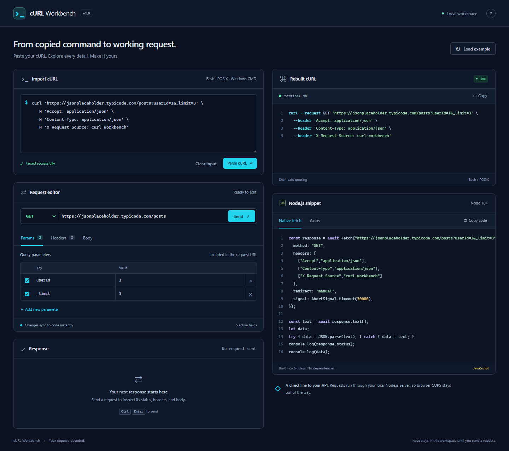
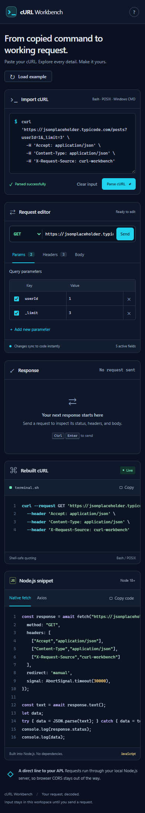

# cURL Workbench

A local Node.js developer tool for turning DevTools cURL commands into editable requests, Bash commands, and Node.js fetch / axios snippets.

## Screenshots

**Desktop**



**Mobile**



## Run

Requires Node.js 18 or newer and npm.

```sh
npm install
npm start
```

Open **http://127.0.0.1:3000**. Set `PORT` to change the listening port. `npm run dev` enables Node's file watcher. No frontend build step is needed.

## Use

1. In browser DevTools → Network, right-click a request and copy it as cURL.
2. Paste the command into **Import cURL**. Parsing runs automatically; **Parse cURL** runs it immediately.
3. Edit the method, base URL, query parameters, headers, or body. Rebuilt cURL and both Node.js snippets update immediately. Checkboxes exclude individual rows.
4. Choose **Send** to execute through the local proxy and inspect status, duration, headers, and body. Click **Cancel** to stop a request.
5. Copy generated code. Save Node.js snippets as `.mjs` files; axios snippets also require `npm install axios`. Generated cURL uses Bash / POSIX quoting.

Shortcuts: **Ctrl/Cmd + Enter** sends; **Ctrl/Cmd + Shift + Enter** parses. Tabs support arrow keys, Home, and End.

## Structure and data flow

```text
server.js                     Express static server + POST /api/proxy
src/public/index.html         Accessible two-column workspace
src/public/css/styles.css     Responsive dark theme
src/public/js/parser.js       Shell tokenizer + request model
src/public/js/generators.js   cURL, fetch, axios + validation
src/public/js/app.js          Reactive editor + response viewer
test/                        Parser, generator, and proxy integration tests
```

Raw command → shell tokens → normalized request model → form editor → generators / proxy → response viewer. Editing the form changes generated output; the original import remains available for reference. No shell commands are executed. Request data is held in memory and is not persisted by the app.

## Supported parsing

Bash/POSIX quotes, ANSI-C `$'…'` escapes, backslash multiline continuations, CMD caret continuations/escapes, Chrome/Edge caret-wrapped CMD groups (`^"…^"`), `curl.exe`, repeated query keys, original query encoding, headers (`-H`, `--header`, including empty `Name;` headers), method (`-X`, `--request`), `--url`, `--data-raw`, `--data`, `-d`, `--data-binary`, inline `--data-urlencode`, cookies, user agent, referer, HEAD, and `--get`. Supports attached short options and `--option=value`. Data implies POST unless a method is explicit. Multiple data options join with `&`, matching cURL. A missing body Content-Type defaults to `application/x-www-form-urlencoded`, matching cURL; add `Content-Type: application/json` for JSON.

Unsupported flags fail visibly. Transport flags such as `--location` and `--insecure` produce warnings; the proxy does not follow redirects or disable TLS verification. File payloads, multipart upload, shell expansion/evaluation, and multiple URLs are unsupported. Use inline body text instead. GET/HEAD bodies cannot run via Node.js fetch and are blocked by validation. Duplicate query parameters and headers remain editable; Node's HTTP clients may combine duplicate headers, while the axios snippet uses one value per header name.

## Proxy contract and limits

`POST /api/proxy` accepts JSON:

```json
{
  "url": "https://example.com/api",
  "method": "POST",
  "headers": [{ "key": "Content-Type", "value": "application/json" }],
  "body": "{\"hello\":\"world\"}"
}
```

Omit `body` for GET/HEAD. Success returns `{ status, statusText, duration, headers, body, size, skippedHeaders }`. Upstream errors (such as 404) are valid responses; proxy failures return `{ error }` with an appropriate status.

The server listens only on `127.0.0.1` and checks Host and Origin. HTTP(S) targets, including local development APIs, are allowed. Do not expose this tool as a public open proxy. Requests have a 30 second timeout, a 2 MB JSON input limit, a 200-header limit, and a 5 MB decoded response limit. Responses are displayed as UTF-8 text; binary file downloads and streaming are outside this version. Transport headers such as Host, Content-Length, Connection and Accept-Encoding are managed by Node.js and listed as skipped. Node fetch may normalize headers and decompress responses, so this is not a byte-for-byte cURL transport emulator. No automatic request runs on page load.

## Publishing

The app includes no API keys or service credentials. Imported requests stay in page memory until **Send**; sent headers and bodies go to the target server. Do not commit `.env` files or real captured requests. The supplied `.gitignore` excludes local environment files, npm credentials, private keys, dependencies, and browser test artifacts. This app is a local developer tool; it is not configured for public hosting or exposed proxy access.

## Contributing

Create a short branch from `main` for each change. Use a Conventional Commit message such as `feat: add request history` or `fix: preserve repeated query keys`. Before opening a pull request, run `npm test` and `npm audit --omit=dev`. GitHub Actions checks Node.js 18, 20, and 22 on pushes and pull requests; Dependabot checks npm and GitHub Actions updates weekly.

Keep `main` releasable: changes enter through reviewed pull requests after CI passes.

## Verify

```sh
npm test
```

Uses Node's built-in test runner, a local HTTP fixture, and no third-party test server. Covers Bash/CMD/ANSI-C parsing, malformed input, query encoding, disabled fields, round-trip reconstruction, generated fetch execution, proxy forwarding, origin/host checks, upstream errors, redirects, timeouts, and response limits.

Parser semantics were checked against the [cURL manual](https://curl.se/docs/manpage.html) and [Chromium's DevTools export tests](https://github.com/ChromeDevTools/devtools-frontend/blob/main/front_end/panels/network/NetworkLogView.test.ts). Static serving and request handling use the [Express API](https://expressjs.com/en/5x/api.html).
